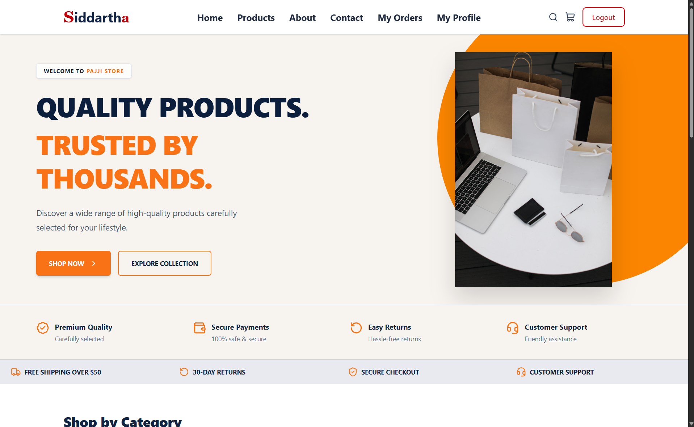
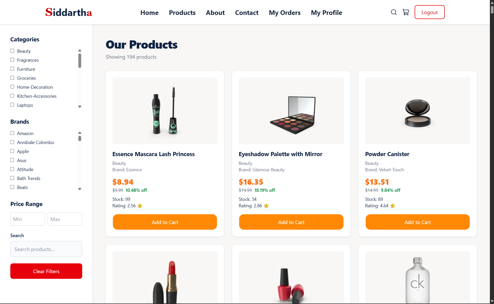
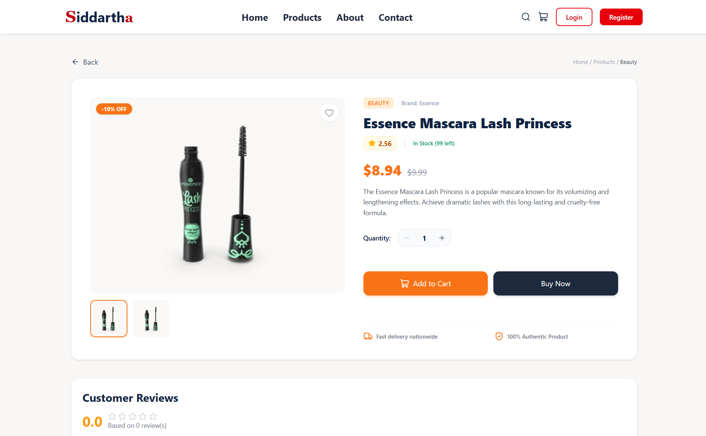
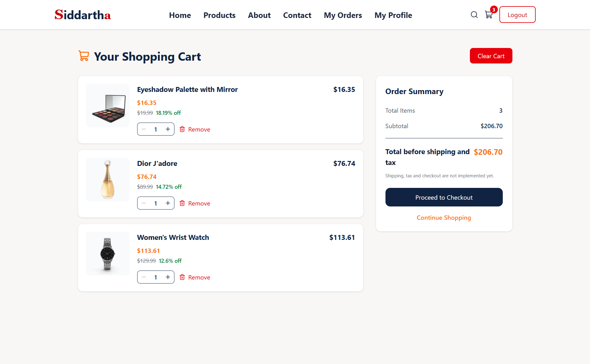
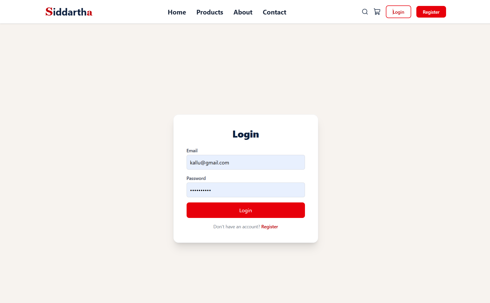
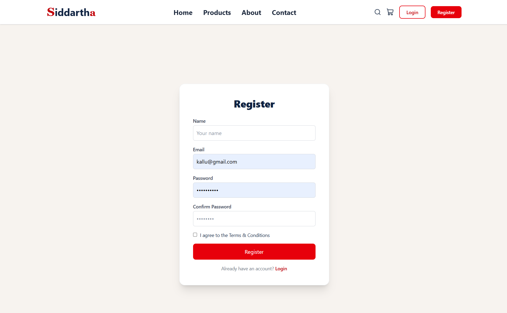
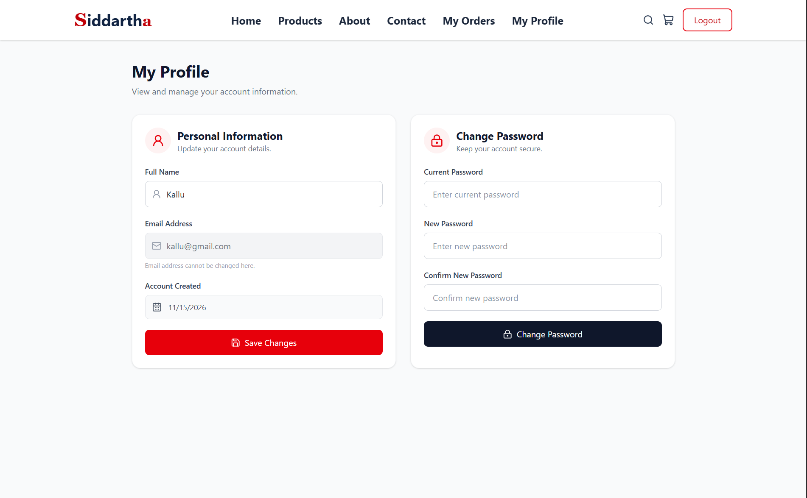
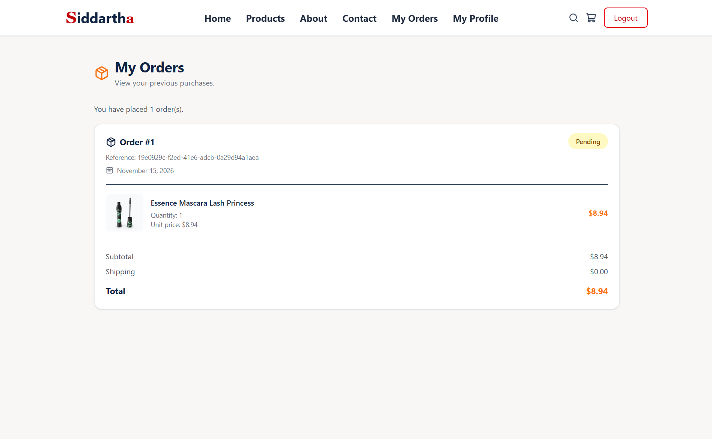
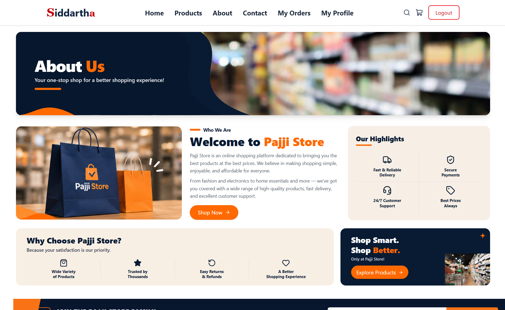
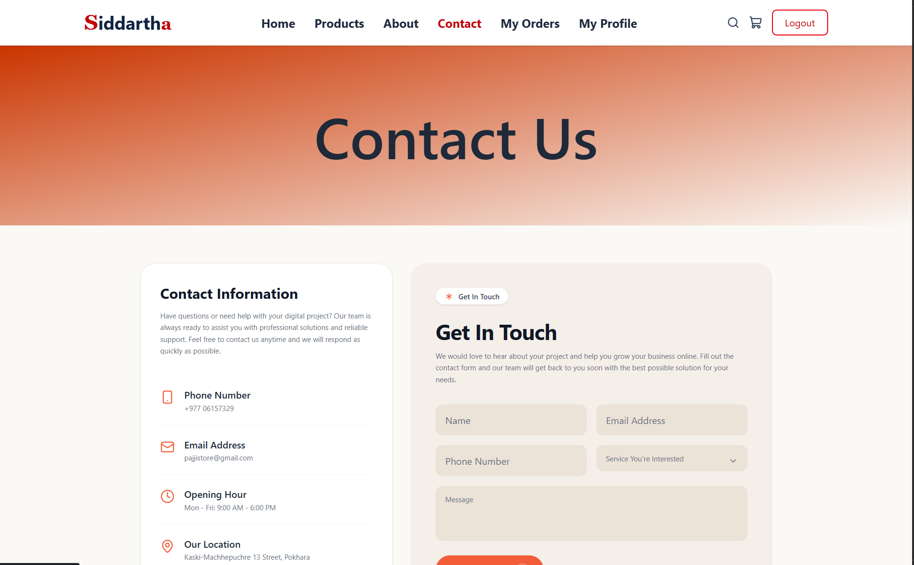

# 🛒 Full-Stack E-Commerce Website

A full-stack e-commerce application built with **React** and **Django REST Framework**. The project provides an online shopping experience with product browsing, user authentication, cart management, orders, reviews, wishlists, and an administrative dashboard.

## ✨ Features

### 🛍️ Shopping Experience
- Responsive e-commerce storefront.
- Product listing and detailed product pages.
- Product search and filtering.
- Category and brand browsing.
- Shopping cart management.
- Wishlist management.

### 👤 User Features
- User registration and login.
- JWT-based authentication.
- User profile management.
- Order placement and order history.
- Product reviews and ratings.

### 🛠️ Administration
- Dedicated admin dashboard.
- Product and user management functionality.
- Order management functionality.
- Backend API permission controls.

## 💻 Technology Stack

| Area | Technologies |
|---|---|
| Frontend | React 19, Vite |
| Styling | Tailwind CSS 4 |
| Routing | React Router |
| HTTP Client | Axios |
| Backend | Python, Django 6.1 |
| API | Django REST Framework |
| Authentication | Simple JWT |
| Database | PostgreSQL |
| Product Data | DummyJSON integration |
| Icons | Lucide React |

## 📁 Project Structure

```text
Full-Ecommerce-Website/
│
├── Backend/
│   ├── Backend/          # Django project configuration
│   ├── account/          # User accounts and authentication
│   ├── product_app/      # Product functionality
│   ├── cart/             # Shopping cart
│   ├── orders/           # Order management
│   ├── reviews/          # Product reviews
│   ├── wishlist/         # Wishlist functionality
│   ├── dashboard/        # Admin dashboard APIs
│   ├── requirements.txt
│   └── manage.py
│
├── Frontend/
│   ├── public/
│   ├── src/
│   │   ├── assets/
│   │   ├── components/
│   │   ├── hooks/
│   │   ├── pages/
│   │   ├── services/
│   │   ├── App.jsx
│   │   └── main.jsx
│   ├── package.json
│   └── vite.config.js
│
├── .gitignore
└── README.md
```

## 🚀 Getting Started

Follow these instructions to run the project locally.

### Prerequisites

Install the following software:

- Python
- Node.js and npm
- PostgreSQL
- Git

### 1. Clone the Repository

```bash
git clone https://github.com/siddarthasubedi1/Full-Ecommerce-Website.git

cd Full-Ecommerce-Website
```

### 2. Backend Setup

Open a terminal:

```bash
cd Backend
```

Create a Python virtual environment:

```bash
python -m venv env
```

Activate it on Windows PowerShell:

```powershell
.\env\Scripts\Activate.ps1
```

Install backend dependencies:

```bash
pip install -r requirements.txt

### Create the PostgreSQL Database

Using pgAdmin:

1. Open pgAdmin and connect to your PostgreSQL server.
2. Right-click Databases.
3. Select Create → Database.
4. Enter `EcommerceDB-demo` as the database name.
5. Save the database.

Make sure the database name and credentials match your `.env` file.
```

### 3. Configure Environment Variables

Create a `.env` file inside the `Backend/` directory.

Configure the following variables with your local PostgreSQL credentials:

```env
DJANGO_SECRET_KEY=your_django_secret_key
DJANGO_DEBUG=True
DJANGO_ALLOWED_HOSTS=127.0.0.1,localhost

DB_NAME=EcommerceDB-demo
DB_USER=your_postgres_username
DB_PASSWORD=your_postgres_password
DB_HOST=localhost
DB_PORT=5432

CORS_ALLOWED_ORIGINS=http://localhost:5173,http://127.0.0.1:5173
```

Make sure the PostgreSQL database exists before running migrations.

### 4. Run Database Migrations

```bash
python manage.py migrate
```

### 5. Start the Django Server

```bash
python manage.py runserver
```

Backend development server:

```text
http://127.0.0.1:8000/
```

### 6. Frontend Setup

Open a second terminal from the project root:

```bash
cd Frontend
```

Install frontend dependencies:

```bash
npm install
```

Start the Vite development server:

```bash
npm run dev
```

Frontend development server:

```text
http://localhost:5173/
```

## 🧪 Available Frontend Scripts

Run these commands from the `Frontend/` directory.

| Command | Description |
|---|---|
| `npm run dev` | Start the development server |
| `npm run build` | Build the frontend for production |
| `npm run preview` | Preview the production build |
| `npm run lint` | Run ESLint checks |

## 🔐 Security Notes

- Never commit `.env` files or database credentials.
- Keep Django's `DEBUG` disabled in production.
- Use secure environment variables for sensitive configuration.
- Configure allowed hosts and CORS origins appropriately before deployment.

## 📸 Screenshots

Here are some screenshots of the Full-Stack E-Commerce Website.

### 🏠 Homepage


### 🛍️ Products


### 📦 Product Details


### 🛒 Shopping Cart


### 👤 User Authentication

**Login**


**Register**


### 👨‍💻 User Profile


### 📋 Order History


### ℹ️ About


### 📞 Contact


## 🚧 Project Status

This project is under active development. Features and improvements are being added as development progresses.

## 📄 License

This project is licensed under the MIT License.
See the [LICENSE](LICENSE) file for details.

## 👨‍💻 Author

**Siddartha Subedi**

GitHub: [@siddarthasubedi1](https://github.com/siddarthasubedi1)

---

If you find this project useful, consider giving it a ⭐ on GitHub.